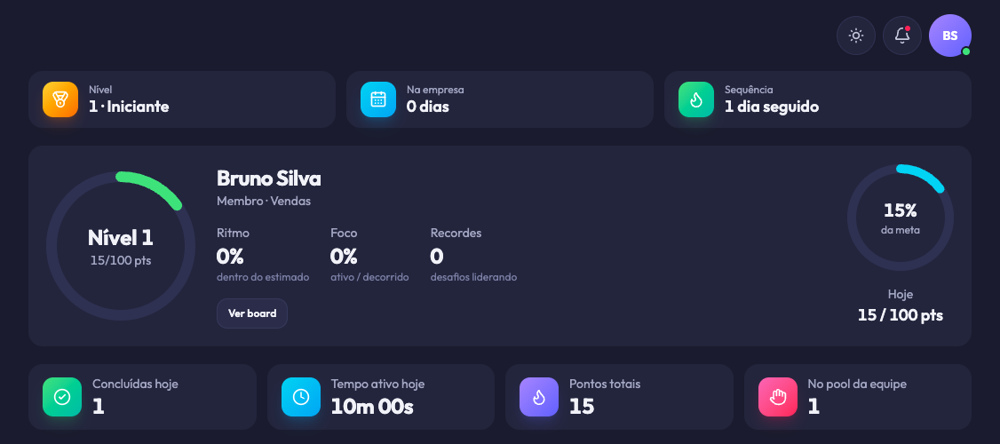
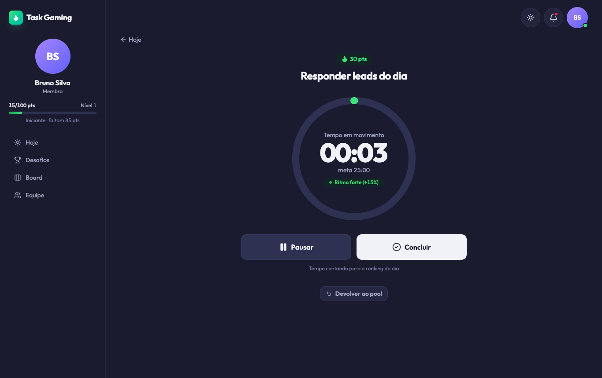
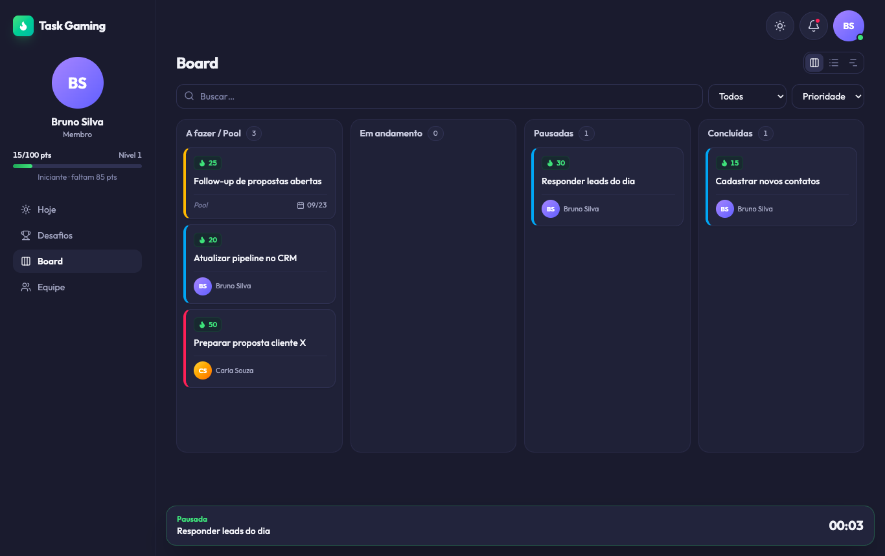
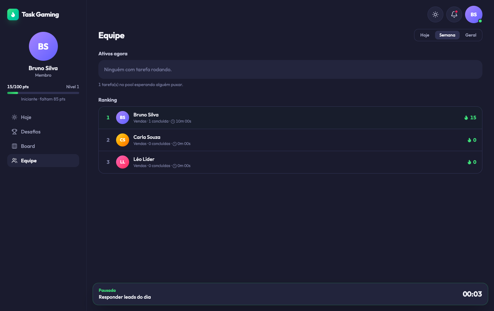
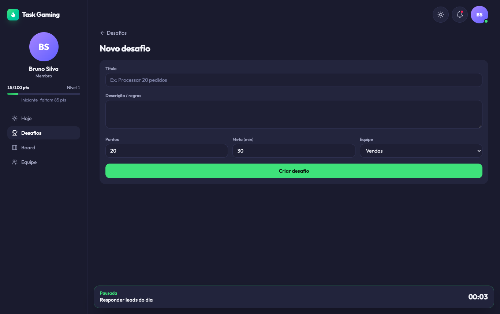
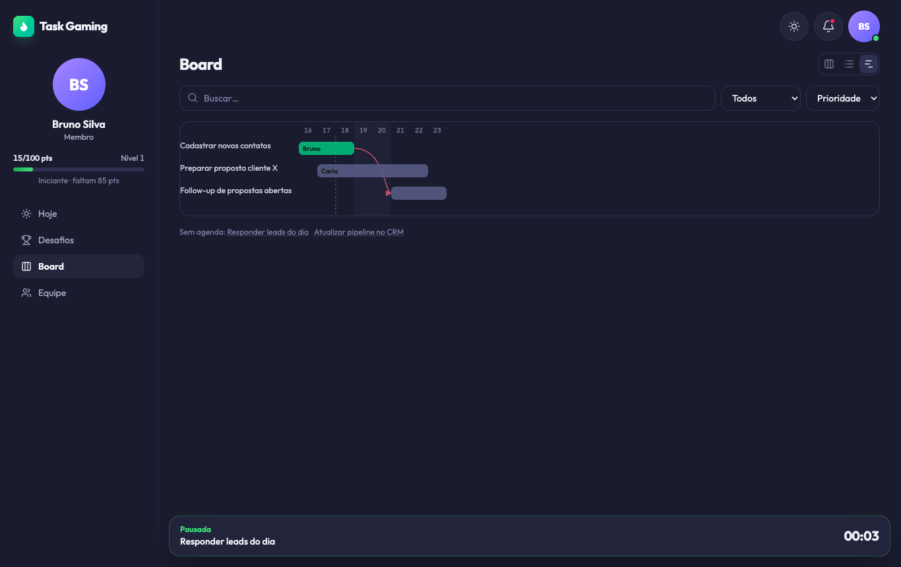
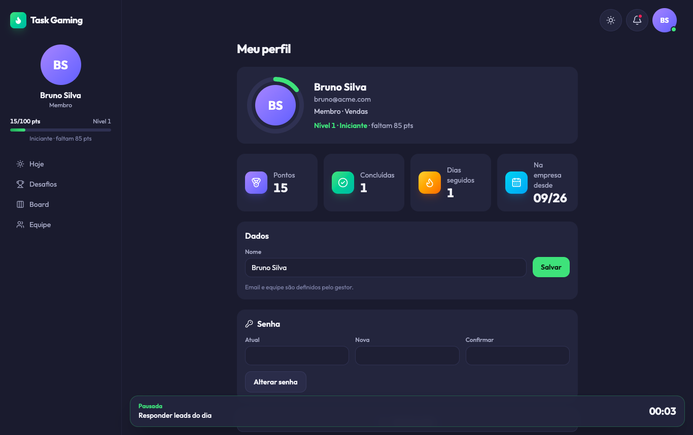
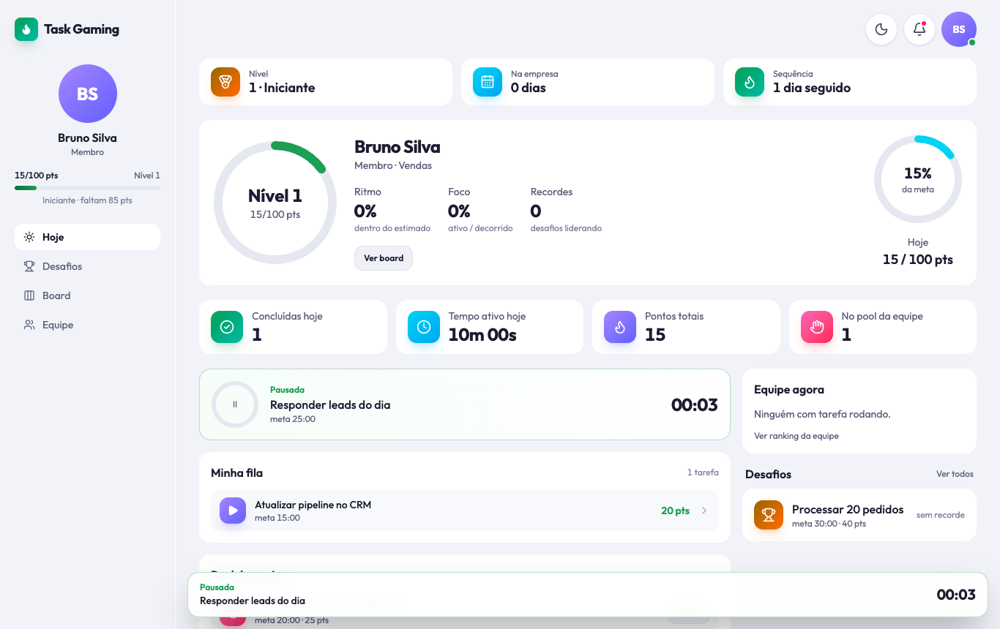
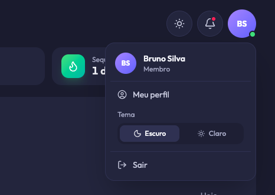
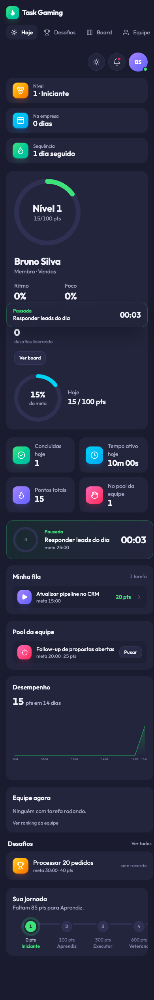

<p align="center">
  
</p>

<h1 align="center">Task Gaming</h1>

<p align="center">
  Gestão de tarefas de trabalho com a mecânica de um app de treino.<br>
  Cronômetro, pontos, níveis, sequência diária, desafios com recorde, Kanban e cronograma — multitenant, para equipes.
</p>

---

## O que é

Cada tarefa é executada num **player cronometrado** (iniciar, pausar, retomar, concluir). Concluir dentro do tempo estimado rende bônus; estourar ou deixar pausada demais desconta. Os pontos alimentam **nível**, **sequência diária** e **ranking da equipe**. Além das tarefas, a equipe cria **desafios**: atividades repetíveis em que cada pessoa tenta bater o recorde de tempo dos colegas.

Por cima disso há a gestão de sempre: Kanban com drag-and-drop, lista com filtros, cronograma com dependências, pool de tarefas da equipe, validação de pontos pelo líder.

## Telas

| Player | Board |
|---|---|
|  |  |

| Equipe | Desafio |
|---|---|
|  |  |

| Cronograma | Perfil |
|---|---|
|  |  |

<details>
<summary><b>Modo claro, menu do usuário e mobile</b></summary>
<br>



| Menu do usuário | Mobile |
|---|---|
|  |  |

</details>

## Como a pontuação funciona

| Regra | Efeito |
|---|---|
| Concluiu em menos de 80% do estimado | **+15%** |
| Entre 80% e 150% | pontos base |
| Acima de 150% | **−10%** a cada 20% extra |
| Ficou ativa menos de 40% do tempo decorrido (muita pausa) | **−20%** |
| Piso | nunca abaixo de 50% dos pontos base |
| Concluiu em menos de 20% do estimado | pontos **retidos** até o líder validar |
| Conclusão manual pelo Kanban (sem cronômetro) | pontos base, sem bônus |

Outras regras que moldam o jogo:

- **Uma tarefa ativa por pessoa.** Iniciar outra pausa a anterior automaticamente.
- **Pool da equipe.** Tarefas sem dono ficam no pool; puxar é atômico — se duas pessoas clicam ao mesmo tempo, só uma leva.
- **Teto de abandono.** Um bloco esquecido aberto (browser fechado, almoço) trava em `max(2 × estimado, 30 min)`, e os intervalos entre blocos têm o mesmo teto. Esquecer de pausar não destrói sua pontuação.
- **Desafio = tarefa repetível.** Cada tentativa é uma tarefa com `challenge_id`; o recorde é o menor tempo em movimento válido (tentativa rejeitada pelo líder não conta, e o empate fica com quem concluiu primeiro). Só o executor pausa e conclui a própria tentativa.
- **Tentativas pontuadas por dia.** Cada desafio define quantas tentativas válidas por pessoa e por dia (no fuso do tenant) rendem pontos, 1 por padrão; as seguintes valem para o tempo e o recorde, mas rendem 0 pontos. Os pontos base de um desafio vão até 1000.
- **Dependências.** Grafo acíclico com detecção de ciclo; tarefa bloqueada não inicia.
- **Sequência.** Dias consecutivos com conclusão válida no fuso do tenant; dia fora dos dias da meta, sem tarefa, não quebra.
- **Níveis.** Iniciante 0 → Aprendiz 100 → Executor 300 → Veterano 600 → Especialista 1000 → Mestre 1500 → Lenda 2500 pontos.
- Pontos, ranking, sequência e nível são **derivados por consulta** — nada é materializado, então nunca ficam inconsistentes.

## Metas e pontuação

Em **Configurações → Metas e pontuação** (abas Metas, Pontuações e Geral) o admin configura dois catálogos separados, cada um vinculável a equipes. A tabela acima é a pontuação de fábrica, que vira a pontuação Padrão de cada tenant.

- **Meta**: pontos por dia (10 a 10000) e os **dias da semana** em que vale. Nos outros dias a meta é nenhuma: a tela Hoje mostra "Dia livre" e a sequência não quebra sem tarefa.
- **Pontuação**: todos os limiares da tabela acima (retenção, bônus de ritmo, estouro, pausa, piso e teto de abandono), em percentuais inteiros de 0 a 1000 (o multiplicador do teto vai de 1 a 100), com um exemplo ao vivo no formulário.
- **Padrão do tenant**: todo tenant tem uma meta e uma pontuação padrão, que não se excluem. Equipe sem vínculo usa a padrão; vincular uma equipe a outra meta ou pontuação **substitui** a padrão para ela. Excluir um item devolve as equipes dele à padrão.
- **Quem está em várias equipes** cumpre a **maior** meta do dia entre as equipes com o dia ativo, e a sequência usa a união dos dias.
- **A regra fica na tarefa.** A pontuação vigente é gravada na tarefa no primeiro início (o *snapshot*): editar uma pontuação só vale para tarefas que ainda não começaram, e o histórico nunca é reescrito.
- **Mudar os dias de uma meta recalcula a sequência de todo mundo, inclusive a passada**, porque ela é derivada por consulta. O formulário avisa e a auditoria guarda o antes e o depois.
- Só o admin configura (`goal.configure`, `scoring.configure`); as capabilities não são delegáveis, para um líder não inflar os pontos da própria equipe. O detalhe da equipe mostra, em leitura, a meta e a pontuação que ela usa.

## Desafios compartilhados

Todo desafio tem uma **equipe dona**, que pode ser a única a competir ou dividir o desafio com outras equipes, ou com o tenant todo, para haver competição entre elas.

- **Quem participa.** A dona e as equipes vinculadas, ou todas as equipes do tenant com **Todo o tenant** (inclusive as criadas depois). O desafio aparece na lista com a etiqueta *Compartilhado · N equipes* ou *Toda a empresa*. O admin sem equipe vê o desafio, mas não compete.
- **Por qual equipe eu compito.** Cada tentativa conta para **uma** equipe sua que participa. Se houver mais de uma, a tela pergunta "Competir por qual equipe?" antes de começar; com uma só, ela entra sozinha. Uma tentativa em aberto é retomada, sem nova escolha.
- **Dois rankings.** *Pessoas*: melhor tempo válido de cada uma, com a equipe pela qual foi feito. *Equipes*: a média do melhor tempo válido de cada participante, com o número de participantes e a parte da equipe que já tentou. Empate: mais participantes, depois quem fechou o resultado antes.
- **Quem valida.** O líder da equipe dona, ou o admin, aprova ou rejeita as tentativas retidas, mesmo as de outras equipes: elas aparecem em **Equipe → Aguardando validação** com o rótulo *Desafio* e a equipe de quem tentou. A rejeitada deixa de valer para o recorde. O líder da dona também cancela tentativas do desafio dele.
- **Pontos.** Por padrão, só a **1ª tentativa válida do dia** rende pontos (configurável por desafio, de 1 a 100); as seguintes valem pelo tempo, com 0 ponto.
- **Compartilhar é unilateral.** Sem aceite da outra equipe. O líder da dona só inclui ou tira equipes que ele mesmo lidera; as demais equipes e o tenant todo são do admin (`challenge.share`). Tirar uma equipe com tentativa em aberto é recusado até a tentativa ser concluída ou cancelada.

## Papéis

Há dois níveis de papel. O **papel de tenant** (`users.role`) diz o que a pessoa é na organização; o **papel de equipe** (`team_members.role`) diz o que ela é *em cada equipe*. Uma pessoa pode estar em várias equipes, com papel diferente em cada uma: líder em A e membro em B.

| Papel de tenant | Pode |
|---|---|
| `SUPER_ADMIN` | criar tenants e o primeiro admin de cada um; entrar como qualquer usuário (impersonação) |
| `TENANT_ADMIN` | equipes, usuários, convites, vínculos e tarefas e desafios de qualquer equipe, ranking geral |
| `MEMBER` | o que o papel dele em cada equipe permite |

| Papel de equipe | Pode, naquela equipe |
|---|---|
| `LEADER` | tarefas, usuários e convites da equipe; cancelar, validar pontos, devolver ao pool; tirar membros da equipe |
| `MEMBER` | executar as próprias tarefas, puxar do pool, criar e tentar desafios da equipe |

Líder não é papel de tenant: quem lidera uma equipe é `MEMBER` no tenant com vínculo `LEADER` nela. O admin que está numa equipe entra como `MEMBER` dela, e a equipe pode ficar sem líder (só o admin gerencia os líderes).

Não existe cadastro aberto. Pessoas entram por **convite por email** (link válido por 7 dias) ou criadas pelo gestor com senha temporária e troca obrigatória no primeiro login. O convite e a criação carregam o papel de tenant (`TENANT_ADMIN` ou `MEMBER`) e, junto da equipe escolhida, o papel de equipe (`LEADER` ou `MEMBER`); cada convite vale para uma equipe. Sessões duram 10 horas; um novo login derruba o anterior.

### Permissões por capability

Cada ação sensível exige uma *capability* (`audit.read`, `user.update`, `export.csv`, `lead.import`…), com um padrão por papel em `src/server/roles.ts`. O gestor geral ajusta, por tenant, o que a pessoa pode **como líder da equipe** e **como membro** em **Configurações → Permissões**; o papel vale por equipe, então quem lidera A e integra B tem os poderes de líder só em A; o papel de admin é fixo, e as capabilities que valem para o tenant inteiro (`tenant.manage`, `tenant.configure`, `team.manage`, `user.update`, `permissions.manage`, `audit.read`, `pipeline.configure`) não são delegáveis. Quem recebe uma capability delegada continua restrito às equipes em que ela vale para o seu papel: criar e editar leads e oportunidades, convites e exportação CSV são conferidos na equipe do registro, não só na entrada. O escopo por equipe (`canManage`/`canSee`, sobre os vínculos em `team_members`) segue valendo por baixo.

### Vínculos com equipes

Quem já tem conta entra em outra equipe, sai dela ou muda de papel nela por vínculos explícitos, cada um auditado (`team.member_added`, `team.member_removed`, `team.member_role_changed`) e idempotente:

| Ação | Quem faz |
|---|---|
| Adicionar uma pessoa a uma equipe | quem tem `team.member.manage` naquela equipe: só o admin por padrão; o admin pode delegá-la ao líder, que então adiciona **apenas como `MEMBER`**, e só nas equipes que lidera |
| Promover a líder, rebaixar ou trocar o papel | só o admin |
| Tirar uma pessoa da equipe | o admin, ou o líder daquela equipe tirando um `MEMBER` dela (nunca outro líder nem a si mesmo) |

Quem sai de uma equipe devolve ao pool só o trabalho aberto *daquela* equipe (tarefas, leads e oportunidades abertas); o das outras continua com a pessoa. Oportunidade fechada guarda o nome de quem a fechou, mas quem saiu da equipe deixa de abri-la. Quem já está na equipe com outro papel não muda de papel ao ser adicionado de novo: a troca é uma ação à parte. `user.update` é só o papel de tenant e só do admin.

Usuários podem ser **desativados** (derruba as sessões e devolve o trabalho aberto, de todas as equipes, ao pool) e reativados. Toda negação de acesso vira um evento `access.denied`.

## Auditoria

Toda mudança relevante grava um evento em `audit_events` **na mesma transação** da mudança: quem fez (e, na impersonação, quem estava por trás), o quê, em qual registro e o valor antes e depois. Cobre tarefas, usuários, convites, equipes, tenants, desafios, dependências, permissões, leads, oportunidades, etapas do funil, logins, falhas de login e impersonação. Os eventos são só de inserção.

- **Configurações → Auditoria** (admins): filtros por ação, entidade, ator e período, diff expansível e exportação CSV.
- Na página de uma tarefa, gestores veem a linha do tempo daquela tarefa.
- Não há purga automática: a tabela só cresce. Se pesar, o caminho é um script de retenção por data.

## Segurança de conta

- **Reset de senha por email**: a resposta é a mesma exista ou não o email. Sem `RESEND_API_KEY`, o link vai para o console do servidor.
- **Rate limit** no login (5 por minuto) e no pedido de reset (3 por 10 minutos), contado em memória, então vale para uma instância. O limite é por IP e lê `x-forwarded-for`: **atrás de proxy, garanta esse cabeçalho**, senão todo mundo cai no mesmo balde.
- **2FA TOTP** com códigos de recuperação, ativado no perfil. O gestor pode **exigir 2FA** para todo o tenant em Configurações → Metas e pontuação → Geral. Ainda não há tela para resetar o 2FA de quem perdeu o celular e os códigos.

## Pipeline comercial

Leads, oportunidades e etapas do funil, multitenant e com a mesma visibilidade por equipe das tarefas.

- **Leads**: cadastro com aviso de duplicado (e-mail ou telefone), pool da equipe com claim atômico, atribuição e **importação CSV** com mapeamento de colunas e prévia.
- **Oportunidades**: nascem da conversão de um lead, na primeira etapa aberta. Mover para *Perdida* exige motivo; sair de uma etapa fechada exige a capability `opportunity.reopen`. Valor guardado em centavos.
- **Pipelines**: o tenant tem vários (Configurações → Pipelines), cada um com as próprias etapas, sempre com ao menos uma aberta, uma ganha e uma perdida; só se exclui etapa nunca usada. Equipe sem vínculo usa o pipeline padrão; vincular a equipe a outro **substitui** o padrão para ela, e o vínculo vale para o que se cria daí em diante, sem reescrever histórico. Desvincular ou arquivar com oportunidade aberta é recusado, e o primeiro vínculo explícito também, enquanto a equipe tiver oportunidade aberta no padrão. A oportunidade nunca muda de pipeline.
- **Funil**: forecast ponderado pela probabilidade da etapa, conversão entre etapas, taxa de ganho e ciclo médio, tudo derivado por consulta.
- **Boards** agrupam tarefas (Configurações → Boards): as colunas continuam sendo o status, e a tarefa pode ficar sem board. Só equipes vinculadas criam tarefas num board, e arquivar ou desvincular com tarefa aberta é recusado. Criar um board já vinculado a equipes exige `team.link` nelas; o líder só gerencia board em que **todas** as equipes vinculadas são dele. Os vínculos de pipeline e board se editam no detalhe da equipe.
- **Follow-ups** são tarefas ligadas à oportunidade: usam o player, o Kanban e os pontos de sempre.
- Pontos por negócio ganho **não** existem ainda: todos os pontos vêm de tarefas.

## Stack

- **TanStack Start** (React, server functions, rotas por arquivo) — sem API separada
- **Better Auth** — email/senha, sessões, plugin admin (criação de usuários e impersonação)
- **Drizzle ORM** + **PostgreSQL 17** (Docker)
- **Tailwind CSS v4** — tema índigo com modo claro, fonte Outfit, sem biblioteca de componentes
- **@dnd-kit** para o Kanban; SVG puro para anéis, gráfico e cronograma
- **Vitest** — testes puros (pontuação, tempo, níveis, ciclos) e de integração contra o Postgres real
- **Resend** para os convites por email

## Rodar localmente

Pré-requisitos: Node 22+, pnpm, Docker.

```bash
cp .env.example .env            # gere BETTER_AUTH_SECRET com: openssl rand -base64 32
pnpm install
pnpm db:up                      # sobe o Postgres em Docker
pnpm db:migrate
pnpm db:seed                    # tenant "Administradora" + super admin (SEED_SUPERADMIN_* do .env)
pnpm dev                        # http://localhost:3100
```

Entre com o super admin, crie um tenant com slug `acme` em **Tenants**, e então:

```bash
pnpm db:seed:demo               # equipe Vendas: leo@acme.com (líder), bruno@ e carla@acme.com (membros) — senha demo-1234
```

Sem `RESEND_API_KEY` no `.env`, o link de convite é impresso no console do servidor em vez de enviado por email.

### Scripts

| Comando | Faz |
|---|---|
| `pnpm dev` | servidor de desenvolvimento na porta 3100 |
| `pnpm build` · `node --env-file=.env .output/server/index.mjs` | build e execução de produção |
| `pnpm test` | vitest (precisa do Postgres de pé) |
| `pnpm typecheck` · `pnpm lint` | TypeScript e ESLint |
| `pnpm db:generate` · `pnpm db:migrate` | migrations do Drizzle |
| `pnpm db:studio` | Drizzle Studio |

## Estrutura

```
src/
  db/            schema.ts (Drizzle), seed.ts, seed-demo.ts
  lib/           auth.ts (Better Auth), auth-client.ts, permissions.ts, theme.ts, format.ts, useElapsed.ts
  server/        *.ts        server functions (uma por domínio)
                 *.core.ts   lógica transacional, testável sem HTTP
                 roles.ts (papéis e capabilities) · audit.core.ts · time.ts · scoring.ts · levels.ts · stats.ts
  routes/        login · forgot-password · reset-password · two-factor · change-password · invite/$token
                 _app/       layout autenticado: index (Hoje), tasks, challenges, board, team, pipeline, leads, opportunities, profile, settings, admin
  components/    Ring, StatTile, Avatar, LevelTrack, PointsChart, TaskPlayer, CompletionModal, Modal (<dialog>), Shell, kanban/, pipeline/, leads/, Notes, NotificationBell, Timeline
docs/screenshots/
```

Convenções que importam:

- Arquivos de server function só exportam `createServerFn` ou valores puros. Qualquer função comum que toque o banco vive em `*.core.ts` — senão o `pg` vaza para o bundle do cliente.
- Toda consulta é filtrada por `tenant_id` vindo da sessão; nunca do cliente.
- Estilos próprios ficam em `@layer base/components` (para não vencer utilitários) e `@apply` só funciona sobre `@utility`.

## Testes

```bash
pnpm test
```

Cobrem: fórmula de pontuação, teto de tempo e gaps, detecção de ciclo, níveis, sequência; e, contra o banco real: claim concorrente do pool, pausa automática ao iniciar outra tarefa, cálculo no fechamento, devolver ao pool, cancelar, validar, conclusão manual, bloqueio por dependência, tentativa de desafio com recorde, aceite de convite.

## Fora de escopo (por enquanto)

OAuth/SSO, anexos (falta decidir onde guardar os arquivos), pontos por negócio ganho, e-mail de notificação, notificações push, WebSockets (o feed e as notificações usam polling de 15 s), API pública e webhooks, testes e2e de UI.
